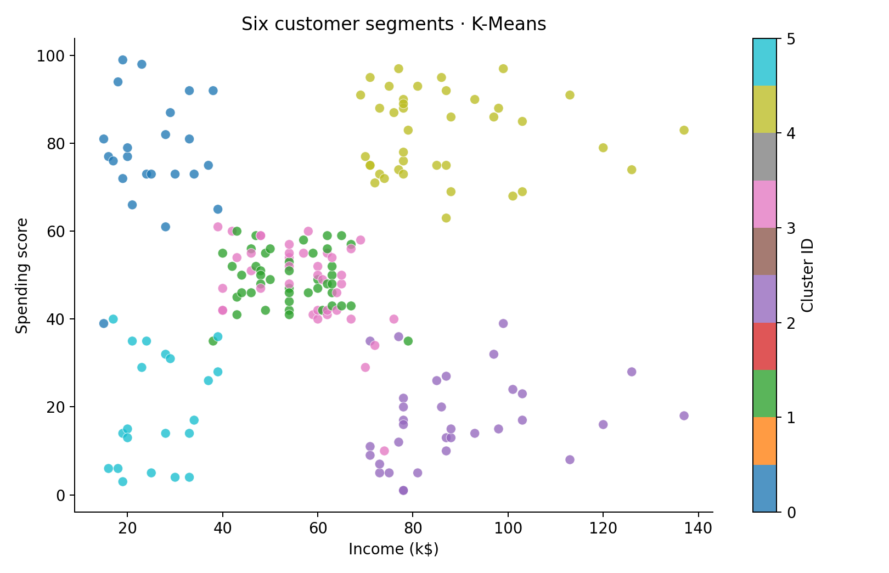
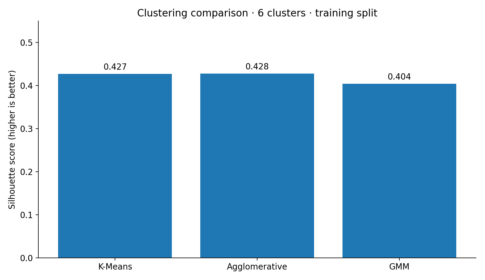
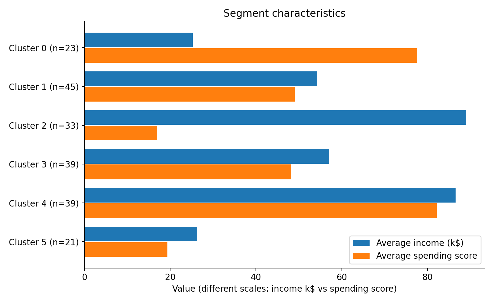

# Customer Segmentation Analysis with Python

An unsupervised machine-learning case study using **200 customer records** to examine how age, income and spending behaviour vary across customer groups. This is an academic portfolio project; its recommendations are hypotheses, not measured business outcomes.



## Project at a glance

- **Tools:** Python, Pandas, NumPy, Matplotlib, scikit-learn
- **Data:** 200 records, 5 source columns; no missing values or exact duplicate rows
- **Approach:** Exploratory data analysis → feature scaling → compare three clustering models → profile segments → discuss business use cases
- **Features used for clustering:** Age, Income (k$), How Much They Spend. Gender is used for descriptive profiling only; CustomerID is excluded.
- **Final segmentation:** 6 K-Means clusters

## Methodology

1. Inspect data quality, variable distributions, scatter plots and outliers.
2. Standardise Age, Income and Spending using `StandardScaler`.
3. Split the scaled observations into an 80% training set and 20% test set. Compare K-Means, Ward Agglomerative Clustering and Gaussian Mixture Model on the **training subset** using three internal cluster-quality metrics. *The original notebook does not report holdout stability results.*
4. Select 6 clusters, taking into account the elbow/silhouette exploration and interpretability. Refit K-Means on all 200 records for final segment profiling.
5. Translate the segment profiles into possible marketing and retention strategies.

## Model comparison (6 clusters, training subset)

| Algorithm | Silhouette ↑ | Davies–Bouldin ↓ | Calinski–Harabasz ↑ |
|---|---:|---:|---:|
| K-Means | 0.4273 | 0.8320 | **108.3497** |
| Agglomerative | **0.4279** | **0.8296** | 105.8841 |
| Gaussian Mixture | 0.4044 | 0.8597 | 95.2590 |

The original notebook recorded a different GMM score in its saved outputs; the GMM row here reflects a new run in this environment (library versions can affect results). K-Means was chosen for its competitive separation, highest Calinski–Harabasz score and ease of interpretation. **Agglomerative clustering performed slightly better on silhouette and Davies–Bouldin**, so the metrics do not establish one uniformly superior algorithm.



## Six customer segments

| Cluster | Customers | Mean age | Mean income (k$) | Mean spending score | Interpretation |
|---|---:|---:|---:|---:|---|
| 0 | 23 | 25.00 | 25.26 | 77.61 | Younger, lower-income, high-spending |
| 1 | 45 | 56.33 | 54.27 | 49.07 | Older, mid-income, moderate-spending |
| 2 | 33 | 41.94 | 88.94 | 16.97 | High-income, low-spending |
| 3 | 39 | 26.79 | 57.10 | 48.13 | Younger adults, mid-income, moderate-spending |
| 4 | 39 | 32.69 | 86.54 | 82.13 | High-income, high-spending |
| 5 | 21 | 45.52 | 26.29 | 19.38 | Lower-income, low-spending |



**Potential actions (not experimentally validated):**

- **Cluster 2:** Test tailored offers and recommendations for high-income customers who currently spend less.
- **Cluster 4:** Consider retention or loyalty initiatives for the high-spending segment.
- **Other groups:** Adjust messaging to spending behaviour rather than assuming income alone predicts purchases.

## Repository structure

```text
customer-segmentation-analysis/
├── README.md
├── data/
│   └── CA2-Customer-Data.csv
├── notebooks/
│   └── customer_segmentation.ipynb
├── images/
│   ├── customer_clusters.png
│   ├── cluster_profiles.png
│   └── model_comparison.png
└── requirements.txt
```

## Run the analysis

1. Create a Python environment and install dependencies: `pip install -r requirements.txt`.
2. Start Jupyter: `jupyter lab` (or `jupyter notebook`).
3. Open **`notebooks/customer_segmentation.ipynb`** and run its cells in order. The notebook's dataset path `../data/CA2-Customer-Data.csv` assumes a notebook working directory of `notebooks/`, as is typical when opened through Jupyter's file browser. If your environment starts from the repo root, adjust the path accordingly.

## Limitations

- This is a small, coursework-scale dataset. Segment structure and business recommendations may not generalise to real customers.
- Cluster IDs are arbitrary; they are not quality rankings. For clarity, this portfolio notebook remaps fitted cluster IDs to the six originally described profiles using closest cluster-mean matching.
- Spending is a **score**, not a monetary total, so it does not directly establish revenue contribution.
- The test split is created in the notebook, but no held-out stability results are reported. Internal scores on the training set are not predictive validation.
- Published data and code should be shared only if permitted under the dataset and course rules.

## Attribution

Adapted from an academic customer-segmentation notebook. The analysis and interpretations are documented for portfolio presentation. Add any collaborators or dataset attribution required by the original assignment before public publication.
